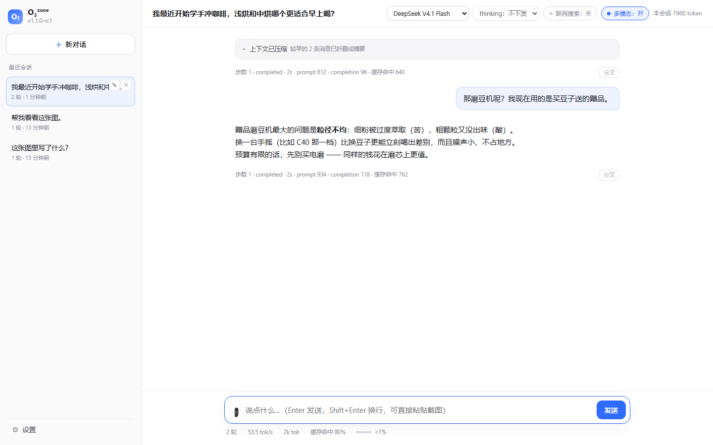
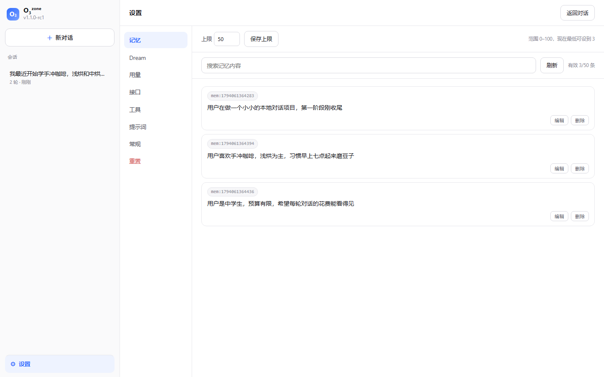

# M5 Web 界面设计说明

## 一句话

给已经跑通的 harness 内核接一个**对标 Kimi 网页端**的界面：
左侧会话列表、流式对话气泡、可折叠的深度思考、工具调用卡片、记忆管理面板、Dream 面板、用量页。



## 为什么还是零依赖

ADR-001 定了"不引入第三方包"。M5 继续遵守：**标准库 `http.server` + 原生 HTML/CSS/JS，无构建步骤**。

收益很直接：`run.cmd --web` 就能跑，不需要 venv、不需要 `npm install`，
几个同学谁都不用先折腾环境。代价是我手写 HTTP 管道（无 WebSocket、无自动 API 文档）。

真要换 FastAPI，只需替换 `harness/web.py`：**前端只认 HTTP + SSE，一行都不用改**。

## 架构

```
浏览器（web/index.html + app.js + style.css）
   │  fetch(POST) + SSE 读取器（手写约 30 行解析）
   ▼
harness/web.py        路由 / 静态文件 / SSE 帧
   │  forward_event(kind, data)  ← 只做一层翻译
   ▼
AgentLoop.emit 事件   （与 CLI 完全相同的来源）
   │
harness/runtime.py    装配（CLI 与 Web **共用同一份**）
```

关键点：**前端不认识 AgentLoop**。它只消费 SSE 事件，
而这些事件与 CLI 渲染的是同一批 —— 所以两个前端不可能出现行为差异。
`forward_event` 是唯一的翻译层，也是唯一值得测的一层（有专门的单元测试）。

`prompt` 事件被刻意丢弃：它含完整提示词，是调试用的（`--show-prompt` 的主场），
每轮推给浏览器既浪费带宽也没人看。

## 端点

| 方法 | 路径 | 说明 |
|---|---|---|
| GET | `/` | 前端页面 |
| GET | `/api/config` | 模型 / 思考档位 / 记忆注入方式 / 是否配了 key |
| GET | `/api/sessions` | 会话列表 |
| GET | `/api/sessions/<id>` | 会话消息（由事件日志重放，刷新即与磁盘一致） |
| GET | `/api/memories` | 记忆库（含来源、是否整理过、当前上限与注入占用） |
| POST | `/api/memories/update` | 编辑一条记忆 |
| POST | `/api/memories/delete` | 硬删除（ADR-109，从原生文件移除） |
| POST | `/api/memories/limit` | 改记忆条数上限（0-100，不得低于已有条数） |
| GET | `/api/dreams` | dream 运行列表 |
| GET | `/api/dreams/<id>` | 逐条改动 |
| POST | `/api/dreams/<id>/undo` | 回滚 〔**已取消**，ADR-065：整理是单向门〕 |
| GET | `/api/usage` | 用量汇总 |
| POST | `/api/chat` | **SSE**：流式对话 |
| POST | `/api/dream` | **SSE**：流式记忆巩固 |

> **这份文档记的是 M5 当时的接口。** 之后变过几处，以代码与
> [M7 设计说明](10-dream-vault.md) 为准：`/api/memories` 不再有别名与来源字段；
> `/api/memories/limit` 是 ADR-057 加的；**回滚接口已删除**（ADR-065）；
> 另加了 `/api/vault`（背景档案：目录树 + README 预算 + 结构校验 + 待整理数）、
> `/api/vault/file?path=…`（点开单个档案：正文 + 元信息 + 邻域 + 内容指纹，ADR-067）
> 以及 `/api/vault/file` 与 `/api/vault/file/delete`
> （在界面上新建 / 编辑 / 删除档案，ADR-070）；
> `/api/dreams/<id>` 改为逐文件差异 + 结构校验。

## 界面功能

- **对话**：流式正文 + 可折叠思考块（思考结束自动折叠，点击可展开）、
  工具调用卡片（绿/红点表示成功失败，点击看参数与结果）、结尾显示步数/耗时/用量。
- **记忆**：搜索、**上限设置**、内联编辑、硬删除（ADR-109；只有 id 与正文，无分类或软删除）。
- **Dream**：待整理状态 + 档案目录树 + 点开看正文（含 frontmatter、双链、反链）
  + **新建 / 编辑 / 删除档案**（ADR-070；保存带内容指纹、删除会报出会变成死链的反链）
  + README 预览 + 结构校验；**整理（带进度日志流）**、运行历史与改动清单、
  **「格式化并初始化 dream」**（双重确认，ADR-072）。
  （预演**已取消**：ADR-072 —— 要重来就格式化，不要"先看一眼"。）
- **用量**：总量与按会话的 token/缓存命中表。
- **主题**：跟随系统 / 浅色 / 深色，可用 `?theme=dark` 深链。



## 安全默认值

- **默认只监听 `127.0.0.1`**。记忆库里是用户画像，绑到 `0.0.0.0` 等于把聊天记录
  和记忆暴露给整个局域网。要对外必须显式 `--host 0.0.0.0`，届时应当先加鉴权。
- **静态文件做了目录穿越防护**：用 `Path.is_relative_to` 校验解析后的真实路径，
  `/../.env` 这类请求返回 404（有测试钉住，否则 `.env` 里的 API key 就泄了）。
- 同一个会话同时只允许一轮生成，占用时返回 409 ——
  否则两份日志会交错写坏历史。

## 怎样验证一个 UI（我没有眼睛，但可以有相机）

我不能"看"网页，但机器上有 Edge。于是：

```powershell
msedge --headless=new --disable-gpu --window-size=1440,900 `
  --virtual-time-budget=6000 --screenshot=shot.png "http://127.0.0.1:8791/#chat/web-demo"
```

`--virtual-time-budget` 让 Blink 快进定时器，等异步数据加载完再截图。
截图回来自己看，然后改样式、再截 —— 这轮就是这样发现并修掉三处问题的：

1. **思考块在"只想不做正文"的那一步永不折叠**，把大段原始思维链一直摊在屏幕上；
2. 非对话视图里侧栏的"最近会话"变成空块（列表被隐藏了但标签还在）；
3. dream 运行摘要被硬切、用量表头「缓存命中」折行。

为此还给前端加了 **hash 路由**（`#chat/<id>`、`#memory`…）：
既让"刷新不丢视图、会话可做书签"成为真功能，也让每张截图都能用一条 URL 复现。

## 已知局限

- ❌ **UI 没有自动化测试**：Python 侧有 17 个 Web 测试（路由、穿越防护、SSE 帧、
  409 锁、UTF-8 解析），但 DOM 行为只能靠截图人工核对 ——
  要自动化就得引入浏览器驱动，与零依赖冲突。
- ❌ 无鉴权、无多用户：定位就是本机单用户。
- ❌ 富文本只做了代码块/行内代码/粗体；不做完整 Markdown（任何解析器都要处理 XSS 面）。
- ❌ 没有文件上传、没有停止后的"继续生成"、没有消息编辑重发。
- ❌ 移动端只是能看，没有为窄屏专门优化。
