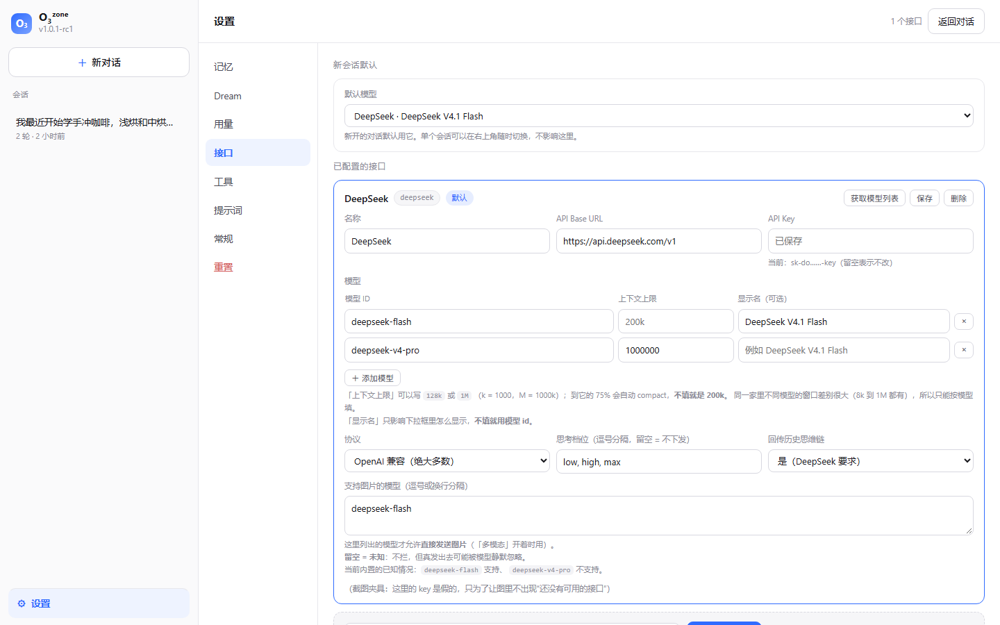
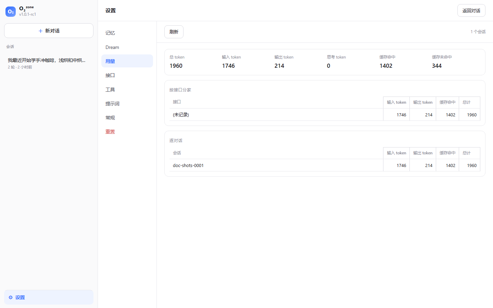
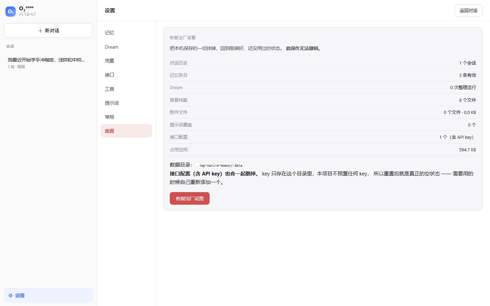

# M6 多供应商与设置面板

## 一、界面重排：设置收到左下角

原来「对话 / 记忆 / Dream / 用量」是顶部四个并排标签，把对话挤在中间。
现在主区只留对话，设置变成左下角一个入口，点进去是带子导航的面板：

```
侧栏                     主区
├ 新对话                 ┌─ 对话（默认）───────────────┐
├ 会话列表               │  顶栏右：模型选择 · thinking 档位 │
└ ⚙ 设置（左下角）        ├─ 设置 ────────────────────┤
      ├ 记忆              │  子导航：记忆 Dream 用量 接口 主题 │
      ├ Dream             └──────────────────────────┘
      ├ 用量
      ├ 接口
      └ 主题
```



## 二、多供应商：一个客户端，三处差异

`/chat/completions` 这套格式事实上是行业通用标准。所以"支持多供应商"
不等于"写很多个 provider"，而是**把差异参数化**。真正有差异的只有三处：

| 差异 | 处理方式 |
|---|---|
| **base_url / key / 模型** | 每家一份"档案"，存在 `data/providers.json` |
| **是否回传历史思维链** | 档案里的 `send_reasoning_content` 开关 |
| **支持哪些 thinking 档位** | 档案里的 `thinking_options`，**留空 = 不下发** |

第一条是常识。后两条值得解释：

### 为什么要一个"回传思维链"开关

DeepSeek 的官方文档规定：携带 `tools` 的请求在后续所有请求中都要完整回传
`reasoning_content`，否则模型在工具循环里会丢掉自己的思考（ADR-008）。
但 OpenAI 官方对消息里的未知字段更严格，塞进去可能被直接拒掉。

**两种默认值都对，只是属于不同的供应商**，所以做成显式开关：
DeepSeek 预设打开，其余预设关闭。CLI `--providers` 能一眼看到每家是哪种。

### 为什么"档位留空 = 不下发"

不同厂商对 thinking 参数的支持千差万别，而**我们不确定每家认哪个参数**。
与其猜，不如：只有档案里明确声明了可选档位时才下发 `reasoning_effort`。
没声明就完全不带这个字段，让供应商用它自己的默认值。

## 三、档案存在哪

```
data/providers.json      ← 每家一份：id / label / base_url / key / 模型 / 档位 / 开关
                           同一个文件里还有两个选择：
                             default —— 新会话默认用哪家哪个模型
                             dream   —— 整理（dream）用哪家哪个模型（ADR-103）
                                        空 = 跟随 default；不影响对话的那个选择
```

- `data/` 已被 `.gitignore` 忽略，**key 不会进仓库**。
- 前端拿到的永远是**掩码后的 key**（`sk-b3……cc6f`）；接口返回里绝不包含完整 key，
  有测试钉住这一点。
- 表单里 key 留空表示"不改动" —— 因为前端手上本来就没有完整 key，
  留空若被当成清空，用户一保存就把自己的 key 删了。

### key 只存在这里，`.env` 一个 key 都不放

**去特殊化**：代码里没有"主供应商"，`.env` 里没有 key，新装好的机器上
一个接口都没有。第一次打开界面会自动把你带到「设置 → 接口」。

为什么这样设计（这是需求里明确要的）：

* 这个项目的 key 是**每个人自己的**。原作者用于测试的那个 DeepSeek key
  不能也不该发给所有人，而且并非人人都有 DeepSeek 账号；
* 只要"某家的 key 藏在 `.env` 里当出厂配置"，那家就事实上是特殊的，
  而且**「恢复出厂设置」永远抹不掉它**；
* 现在 key 只存在 `data/` 里，所以重置 = 真正的空状态（有测试扫磁盘确认 key 不再出现）。

`.env` 现在只管**行为**（预算、熔断、compact 阈值、数据目录），不管**身份**。

> 踩过的坑（已随之消失）：早年种档案时 `base_url` 取的是预设里的官方地址，
> 后果是任何自定义端点在首次运行后被**静默**改回 `api.deepseek.com`。
> 现在没有"种档案"这回事了，但"加接口时不能覆盖用户填的地址"仍有一条回归测试钉着。

## 四、模型列表为什么不预填

除 DeepSeek 外，**预设里刻意不写模型名**。我们不掌握各家当前在售的模型 id，
写死只会带来过期与误导。改成点一下「获取模型列表」→ 调该供应商的 `/models`
（OpenAI 兼容接口的通用能力）→ 拿到的是真实的。

## 五、会话内直接切换模型与档位

对话页右上角有两个下拉框：模型（按供应商分组）与 thinking 档位。
**不需要进设置**。

- 选择**跟着会话走**：切换时会追加一条 `session_settings` 事件（append-only，符合 ADR-006），
  刷新页面或重新打开这个会话时会恢复成同一模型。
- 设置里的「新会话默认」是另一回事：只影响**新开**的对话，
  不会因为你某个会话换了模型就把所有会话都改掉。
- 档位下拉的选项来自该供应商档案的 `thinking_options`；某家没声明档位时，
  下拉会显示"不下发"并禁用。

## 六、内置的预设

| 预设 | Base URL | 协议 | 备注 |
|---|---|---|---|
| **Kimi Code（订阅 token plan）** | `api.kimi.com/coding/v1` | **Anthropic** | 会员额度，key 来自 kimi.com/code 控制台，**已实测** |
| **Kimi Code（海外）** | `api.kimi.ai/coding/v1` | **Anthropic** | 同上，海外站 |
| Kimi 开放平台（按量付费） | `api.moonshot.cn/v1` | OpenAI | 与 Kimi Code 是**两套 key** |
| Kimi 开放平台（海外） | `api.moonshot.ai/v1` | OpenAI | 同上 |
| DeepSeek | `api.deepseek.com` | OpenAI | 本项目实测的供应商，预填两个模型 |
| 智谱 GLM | `open.bigmodel.cn/api/paas/v4` | OpenAI | 有免费档 |
| 通义千问 | `dashscope.aliyuncs.com/compatible-mode/v1` | OpenAI | 有免费额度 |
| 硅基流动 | `api.siliconflow.cn/v1` | OpenAI | 有免费模型 |
| OpenRouter | `openrouter.ai/api/v1` | OpenAI | 一个 key 调多家 |
| OpenAI | `api.openai.com/v1` | OpenAI | 默认不回传思维链 |
| 本地 Ollama | `127.0.0.1:11434/v1` | OpenAI | **完全离线零成本**，适合先试 |

预设只是起点：加进来之后每个字段都能改，也可以"自定义"直接填 base_url。

## 六点五、为什么多了一个 Anthropic 客户端

调研后发现 Kimi 的两条产品线用的是**两套不同的协议**（来源：
[Kimi Code FAQ](https://www.kimi.com/code/docs/en/kimi-code/faq.html)、
[kimi-cli providers 文档](https://moonshotai.github.io/kimi-cli/en/configuration/providers.html)）：

| 平台 | Base URL | 格式 | 计费 |
|---|---|---|---|
| **Kimi Code**（订阅 token plan） | `api.kimi.com/coding/v1` | **Anthropic 兼容** | 会员订阅 |
| Kimi 开放平台 | `api.moonshot.cn/v1` | OpenAI 格式 | 按量付费 |

**base_url 必须带 `/v1`**，这一点值得单独说：对**对话**端点其实两种写法等价
（客户端会把 `/v1` 归一化后拼成 `/v1/messages`），但**「获取模型列表」是直接拼 `/models` 的** ——
少了 `/v1` 就会打到 `https://api.kimi.com/coding/models`（错的）。
实测确认：带上 `/v1` 后立刻拿到了 `k3` / `k3-256k` / `kimi-for-coding` /
`kimi-for-coding-highspeed` 这些真实在售的模型 id。

顺手还修了一个相关的坑：模型发现原本只发 `Authorization: Bearer`，
而 Anthropic 风格的端点认 `x-api-key`。现在**两个头一起发** ——
多发一个用不上的头是无害的，少发一个就直接 401。

而本站大多数人的 key 来自 **Kimi Code 订阅**，所以只支持 OpenAI 格式等于用不了。
于是补了 `providers/anthropic_compat.py`。

两套协议差的不只是 URL，**消息结构本身就不同**：

| | OpenAI 格式 | Anthropic 格式 |
|---|---|---|
| system | 放在 messages 里 | 顶层 `system` 参数 |
| 工具定义 | `{type:"function", function:{name, parameters}}` | `{name, input_schema}` |
| 工具调用 | assistant 的 `tool_calls` 字段 | assistant 的 `tool_use` 内容块 |
| 工具结果 | `role:"tool"` 消息 | `role:"user"` + `tool_result` 块，且必须紧跟调用 |
| 流式事件 | `choices[].delta` | `content_block_start/delta` 事件 |
| 停止原因 | `stop`/`tool_calls`/`length` | `end_turn`/`tool_use`/`max_tokens` |

顺手把停止原因**映射回我们内部的词汇**，其中 `max_tokens → length` 很关键：
ADR-023 那条"截断不能被当成正常完成"的守卫依赖它。

> ✅ **已实测通过**（2026-10-06）：用真实 Kimi Code key 完成了一整轮对话 ——
> `provider=kimi-code`、`model=kimi-for-coding`、steps=1、reason=completed、
> prompt 1071 / completion 57，模型正确回答并**按记忆主动提起用户偏好**。
> 也就是说 system 顶层参数、`x-api-key` 鉴权、SSE 解析、`end_turn → completed`
> 映射、用量归属全部走通了，而且记忆注入在换了一整套协议之后依然生效。

## 七、用量统计：按接口分家，估算花费已永久移除

用量页现在长这样：总计卡片 + 「按接口分家」表 + 「逐对话」表（逐对话那张保持原样）。



**估算花费为什么删掉而不是留着**：单价表只能对一家成立。支持多供应商之后，
"估算花费"会拿 DeepSeek 的单价去算别家的用量 —— **一个错的数字比没有数字更糟**。
所以连同计费代码、配置键、测试一起删干净了，只留下一个守卫测试：
如果哪天有人把计费字段加回 Settings，那条测试会红，提醒他先想清楚多供应商下单价怎么算。

官方价目仍值得知道（它解释了为什么这套 harness 花大力气安排消息顺序）：
输入·缓存命中比未命中便宜 **50 倍**（0.02 对 1 元），空闲时段是高峰的半价。
这些数字留在 [`06-getting-started.md`](06-getting-started.md) 当背景资料。

**按接口分家怎么算的**：不能只看 `session_start` —— 一个会话中途可能换过接口。
所以沿着事件走，遇到 `session_settings` 就更新"当前供应商"，
这样"换模型之后的那几轮"才会算到新供应商头上。
早期（M6 之前）的会话没有 provider 字段，会归到「（未记录）」。

## 八、恢复出厂设置（危险区）

设置里最后一项是 **重置**：点「恢复出厂设置」→ 弹出 **「确认恢复出厂设置？」** →
确认后抹掉本机保存的一切，回到刚装好、还没用过的状态。



确认框会先把**具体数量**列出来，并要求输入确认词 —— 比"确定吗？"有用得多。

它是整个项目里**唯一一个破坏性且不可逆**的操作，所以每一条设计都围绕"别让人误删"：

| 设计 | 为什么 |
|---|---|
| **GET 只预览，POST 才执行** | 一个误点的链接、一次刷新、一个预取都不该抹掉数据 |
| 预览走**只读**路径 | 打开设置页看一眼，不能顺手把 memory_instruction.md / memory.db / providers.json 建出来 |
| 确认框**列出具体数量** | "删掉 6 个会话、170 条记忆、1 个接口（含 API key）、690 KB"比"确定吗？"有用得多 |
| 按钮写**永久删除**而不是"确定" | 确认按钮上应当写着这个操作真正会做什么 |
| **不偷偷备份** | 用户要的是"抹掉"。留一份隐藏副本会变成隐私问题（有测试钉住不留残留） |
| **把 key 也带走** | key 只存在 `data/` 里，所以重置是真正的空状态。有测试扫磁盘确认 key 不再出现 |

**删完会怎样**：`data/` 里的东西全部消失，然后从 `.env` 重新种出一个默认接口 ——
这正是"出厂态"。界面上添加的接口（例如 Kimi Code）都会没，key 要重新粘贴。

> 实现上先**把数据目录改名挪走**再删（改名是原子的），而不是逐个删文件：
> 中途失败只会留下一个名字里带 `.deleting-` 的目录（会如实上报给界面），
> 而不是一个"删了一半"、看起来像坏了的数据目录。

## 九、已知局限

- ✅ **Anthropic 客户端已实测跑通**（Kimi Code 国内站）。海外站未测。
- ❌ 不支持 Anthropic 的 extended thinking 回传：思维块需要带签名的 thinking block 才能回传，
  实现成本高。当前**不回传**，所以模型看不到自己上一步的思考（对话仍正常）。
  Kimi Code 实测 `reasoning_tokens=0`，本来也没返回思考内容。
- ❌ 不自动探测供应商能力：`supports_tools` 只是档案上的一个布尔值加一条界面警告。
  真正不支持工具调用的模型加进来后，**记忆功能会失效**（模型没法调用记忆工具）。
- ❌ 不支持图像输入（DeepSeek 的 flash 支持视觉，但我们没做多模态消息）。
- ❌ 模型列表不缓存过期时间，也不会自动刷新。
- ❌ 上下文窗口要手填，**只能按模型填**（同一家差别太大：Kimi 有 8k 也有 256k，
  DeepSeek 从 64k 到 1M）。**没填就是 200k**。填错不会坏，只会让自动 compact 早/晚触发。
