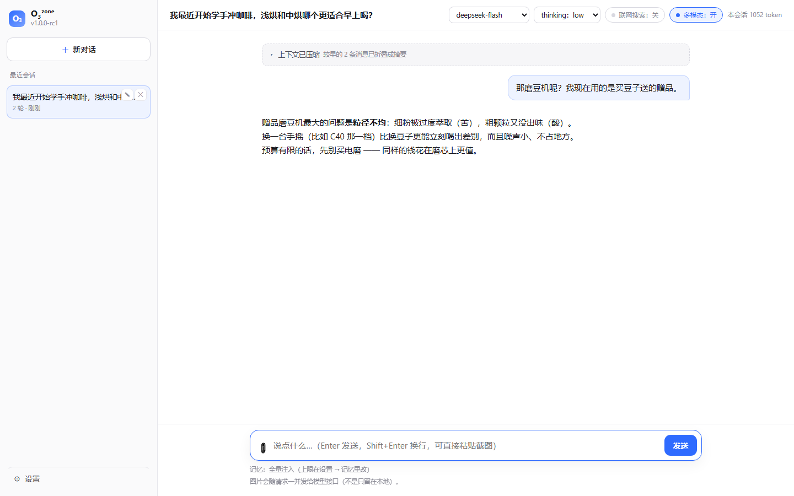

# 自动 compact（上下文压缩）

## 为什么需要它

在这之前，历史超过预算的处理方式是**按组丢弃最旧的** —— 干净、可预测，
但有个致命缺陷：**信息凭空消失了**，而且模型不知道自己丢了什么。
用户问起很早之前聊过的事，它会一脸茫然，甚至可能编一个。

compact 把"丢弃"换成"压缩"：较早的对话交给模型自己总结成一份事实摘要，
摘要（而不是原文）留在后续上下文里。信息被浓缩，但没有消失。



## 在哪里触发：两层约束取较小值

这是这个功能最需要讲清楚的一点。

```
history_budget = min(
    HARNESS_CONTEXT_TOKEN_BUDGET,        # 我们自己的成本上限（默认 24000）
    context_window - 系统提示与输出的余量  # 本轮选中模型的能力上限
)
```

**为什么不能只按模型窗口来**：模型的上下文窗口讲的是**能力**，不是**花钱许可**。
一个 1M 窗口的模型如果把历史塞到 75 万 token，每轮输入就要 0.75 元 ——
对一个"没多少钱"的项目来说是灾难。所以成本上限是独立的一根闸。

**为什么窗口这一半也必须认真对待**：它随**本轮选中的模型**变。
`resolve_settings()` 会把选中档案/模型的 `context_window` 折算进 Settings，
所以换个 32K 窗口的模型，compact 会明显更早触发；
换回 1M 的模型，就回到由成本上限说话。

每家的窗口在「设置 → 接口」里**按模型**填（那张模型表格的「上下文上限」一列，
因为同一家里不同模型的窗口也不一样；可以写 `128k` / `1M`，k = 1000、M = 1000k）。
**填错不会坏**，只会让它早/晚触发。

到达 `history_budget × 0.75` 就开始压缩，压到只剩最近 `× 0.35` 的历史。

## 压缩怎么发生

```
1. 估算当前历史 token；没到阈值就什么都不做（绝大多数轮次都走这条）
2. 按"用户消息"切成组（与裁剪同一套分组逻辑，绝不切开工具调用与结果）
3. 保留最近的若干组到 target，其余准备折叠
4. 再按"摘要输入长度"上限**整组退让**：宁可少折叠几组，也不截断送进摘要的文本
5. 调一次模型：把「上一版摘要 + 待折叠对话」合并成一份新摘要
6. 把摘要写进会话日志：一条 session_summary 事件
7. 之后这个会话的上下文 = 主 system + 摘要 + 未被覆盖的后半段历史
```

摘要作为一条 system 消息，**紧跟主 system 消息**注入 —— 位置固定、不常变，
对 prompt 前缀缓存最友好（而它一变，本来也只能作废一次）。

> 注意"最友好"的前提已经被修正过一次（ADR-044）：真正的问题不是摘要放哪，
> 而是**时间**当时放在 system 里 —— 它在摘要与整段历史之前，跨一分钟就把它们全废掉。
> 现在每轮易变的信息（时间、裁剪提示）统一放在**整个请求的最后一条消息**。

## 设计上的几个选择

**摘要是一条事件，不是覆盖写。** 与 ADR-006 一致：原始消息仍在 JSONL 里，
只是不再进入上下文。所以 `--replay` 依然能看到当时真正发生过什么，
而摘要只是"当前生效的视图"。

**水位线按「组数」记，不按条数。**（这条推翻了自己早先的写法，见 ADR-046）
`session_summary` 里现在存 `covered_groups`，读取时按组切。
理由很具体：重放层会给"没有结果的工具调用"补一条 tool 结果（ADR-045），
**组内多一条消息**——按条数记的话切点会偏移到组的中间，
切出一个孤立的 tool 消息，那种请求 API 直接 400。
老日志里只有 `covered_messages`，所以条数仍然保留做回退，
并且回退路径会**校验切点必须落在 user 消息上**。

**摘要输入宁可不折叠，也不截断。** 早先是把**完整的**折叠集合记为"已覆盖"，
但送进摘要的文本超过 `compact_max_input_chars` 时会被截掉尾巴 ——
于是被截掉的那段既没进摘要、又被永久标记为已覆盖，
正是这个功能要消灭的"信息凭空消失"。现在逐组累积到预算以内；
**最早那一组本身就超上限时直接放弃压缩**（发 warn，退回按组丢弃）。

**摘要失败要能兜底。** 模型没返回摘要时，发一条 warn 提示，退回旧的"丢弃最旧"行为，
**绝不能因此让这一轮对话失败**。同一条纪律也覆盖"压缩阶段抛出别的异常"：
`run()` 把整个压缩步骤包在 try 里，出错就跳过压缩并留下 warn，
保证这一轮照常有回复、有 `turn_end`。

**压缩的开销算进本轮用量。** 那一次摘要调用是真花钱的，
漏掉它会让用量页少算（有测试钉住）。

## 实测

```
上下文接近上限（约 696 token，预算 320），正在把较早的 20 条消息压缩成摘要…
→ 摘要调用：prompt 707 / completion 977（其中思考 817）
→ 20 条消息折叠成一份约 400 字的摘要
```

模型给出的摘要质量出乎意料地好，它甚至注意到了一件我自己都没在意的事：

> 已确认："跟吃有关"的是学做菜、周末回家吃饭；"多肉死了"指盆栽植物，非食物。
> …助手此前"记下了"多为口头回应，实际只记录了学川菜一条。

最后那句是它**自己发现**"助手说过很多次'记下了'但只真写了一条记忆" ——
这正是把历史交给模型自己压缩的价值。

## 踩过的坑（与 M4 的 dream 一模一样）

`compact_max_output_tokens` 最初设成 1024，实测一次 400 字摘要用掉 **977** token
（其中 **817 是思考**）—— 已经贴到上限，**差点被截断**。

教训和 ADR-023 完全一致：**默认开启思考的模型，输出上限不能贴着"预期输出长度"设**，
因为思考会吃掉大部分预算。现在默认 2048。

## 已知局限

- ❌ 摘要质量没有自动校验：压得不好（漏了关键事实）只能靠人看。摘要块可展开查看。
- ❌ 不会"反向"利用摘要：压缩是单向的，不会因为后来需要细节而回到原文
  （原文还在日志里，但当前没有"按需调回"的机制）。
- ❌ 一次性压缩的量取决于 target 比例，没有做"分批多次压缩更省"的优化。
- ❌ 摘要调用本身也走思考模式，所以它比"纯摘要"贵一倍左右；关不掉
  （DeepSeek 的 `thinking` 开关走 `extra_body`，我们的通用客户端没有暴露）。
